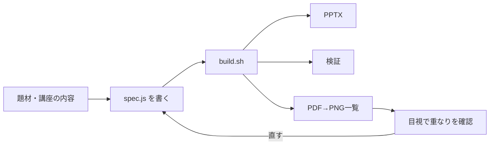

## 先に結論

研修用の「書き込み式PPT」（ドリル、事前ヒアリングシート）を、**spec.js 1本から量産する仕組み**を作りました。Claude Skill 3本と、ビルドキット（pptxgenjs）の組み合わせです。

1. 内容は spec.js に書く（スライド1枚＝1オブジェクト）
2. `bash build.sh <作業フォルダ>` で、PPT・検証・PDF・目視用の一覧画像まで出る
3. 型（書き込み方）は、`layout` の名前を変えるだけで切り替わる

この記事は、作ったものの紹介と、実際に踏んだ落とし穴の共有です。

## 作ったもの

| Skill | 役割 |
|---|---|
| usausa-ppt-writein-drill-builder | 書き込み式ドリル（問題＋解答と解説）。ビルドキットを持つ |
| usausa-pre-hearing-sheet-builder | 研修前に、お客様が書く事前ヒアリングシートと、回収後の整理表 |
| usausa-writein-pattern-catalog | 書き込みの型13種の選び方と、データの形 |

## 全体の流れ



ポイントは、**目視の工程をスクリプトに組み込んだ**ことです。表と下の帯の重なりなどは、PDF→PNGの一覧画像で見ると、すぐ分かります。

## spec.js の形

1枚のスライドは、次のような1オブジェクトです。

```js
add({ part: 0, layout: 'wtable', title: 'A1 数字の穴埋め',
  q: '数字を、正確に言えますか？',
  tag: { k: '公式', t: '出典名（確認日）' },
  data: { colW: [6.0, 2.4, 3.73], head: ['問い', 'ヒント', '答え（書く）'],
          rows: [['問い文', '講座スライド5', '']] },
  hint: '帯に出す一言' });
```

空文字のセルは白（記入欄）になります。解答スライドも、同じ `wtable` で作れます。

## 書き込みの型

カタログに、13の型を整理しました。使う `layout` の例です。

| 型 | layout | 書き込み方 |
|---|---|---|
| 穴埋め表 | wtable | 表の空白セルに書く |
| 線つなぎ | wmatch | 左の番号に、右の記号を書く |
| 並べ替え | wsort | カードの丸に、順番を書く |
| 自己評価 | wscale | 1〜5の丸を色で塗る＋ひとこと |
| 仕分け | wbins | 言葉を、分類の枠に書き写す |
| コード穴埋め | wcode | コードの（1）（2）を、右の枠に書く |
| 事例分析 | wcase | 事例を読み、原因・確認・対応を書く |
| 選択式 | wchoice | □を■にする＋その他 |

組み立ての例です。

1. ドリル：穴埋め → 線つなぎ → 並べ替え → 仕分け → コード穴埋め → 事例分析 → 設計
2. 事前ヒアリング：自由記述 → 表 → 自己評価 → 選択式 → 仕分け → チェック

同じ型を3枚続けない。単調さを避けるための、小さなルールです。

## 事前ヒアリングで決めたルール

1. 「なぜ聞くか」「回答をどう使うか」を決めた質問だけ入れる
2. 全部は埋めなくてよい。空欄は、当日に聞く
3. パスワード・キー・個人名・社外秘の中身は、書かせない
4. 自己評価は、授業の速さを決めるため。評価（合否）ではない

回収後の整理表（質問／なぜ聞くか／回答の使い方／未記入のときの聞き方）も、セットで作ります。

## 踏んだ落とし穴

1. **書き込み表は、データ行5行まで。** 6行以上だと、下の「ポイント」帯と重なる
2. 帯の文章が長いと、文字が小さくなる。2行までにする
3. タイトルは約26文字以内。長いと、問いの帯とぶつかる
4. spec.js を文字置換で直すと、括弧が余ってビルドが壊れる。直したら `node -e "require('./spec.js')"` で確認する
5. レイアウトを足すとき、既存のspecで同じ枚数がビルドできるか（回帰）を確認する。今回は、24枚のドリルで確認した

## 確認したこと／未確認のこと

確認したこと：

1. ビルドキットを、別のフォルダで単独実行し、ドリル24枚・ヒアリング11枚・パターン見本10枚が作れて、検証に通ること
2. 画像で、重なりとはみ出しが無いこと

未確認のこと：

1. PowerPoint以外のアプリ（Keynote、Googleスライド）での見え方
2. 「丸を色で塗る」「□を■にする」操作の使いやすさ（お客様に書いてもらって確かめる）
3. Skillとして保存したあとの、自動起動のされ方
4. Dify以外の題材での、ドリル作成

## まとめ

1. 内容は spec.js、見た目はビルドキットに分けると、量産しやすい
2. 型をカタログにすると、「内容に合う型」を選ぶ時間が減る
3. 目視をスクリプトに入れると、重なりの見落としが減る

次は、別の題材でドリルを1本作り、見つけた落とし穴をSkillに足します。
